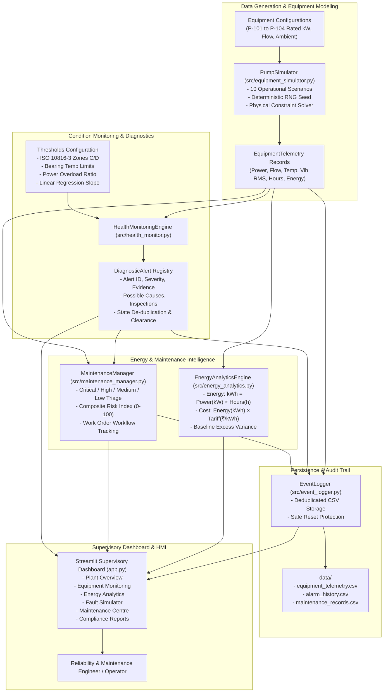

# Industrial Pump Health, Energy Monitoring & Predictive Maintenance System

[](https://www.python.org/)
[](https://streamlit.io/)
[](https://pytest.org/)
[](https://www.iso.org/standard/43110.html)

A production-grade, simulation-based engineering portfolio project designed for **Graduate Engineer Trainee (GET)** candidates preparing for industrial process companies, including **Reliance Industries Limited (RIL)**, **IOCL**, **ONGC**, **L&T Energy**, and **Tata Chemicals**.

This system implements end-to-end condition monitoring, ISO 10816-3 mechanical vibration analysis, electrical energy accounting, and explainable rule-based maintenance triage for centrifugal pumps and induction motors.

---

## 1. Industrial Problem Statement

Centrifugal pumps driven by electric induction motors are the workhorses of continuous process facilities—operating in boiler feedwater systems, cooling water circulation loops, refinery distillation units, and wastewater treatment plants.

In real-world facilities:
- **Mechanical Deterioration**: Dynamic rotor unbalance, shaft angular/parallel misalignment, bearing fatigue micro-pitting, and foundation bolt looseness induce damaging vibrations.
- **Thermal Distress**: Inadequate grease replenishment, high ambient temperatures, or internal rubbing cause bearing temperatures to elevate, accelerating oil film breakdown.
- **Energy Waste**: Hydraulic wear-ring degradation, internal recirculation, impeller fouling, and off-design operation increase motor electrical power demand, resulting in thousands of kilowatt-hours of excess energy waste and substantial financial penalties.
- **Unplanned Downtime**: Unmonitored progressive degradation risks sudden motor trips, catastrophic bearing seizure, and costly unplanned unit outages.

This educational system models multi-variable pump telemetry, detects abnormal patterns using transparent engineering rules, accounts for electricity expenditures, and prioritizes maintenance inspections without resorting to black-box machine learning.

> [!NOTE]
> **Engineering Disclaimer**: This is an educational, simulation-based portfolio application. It utilizes synthetic telemetry governed by physical relationships. It does not claim real plant deployment, certified energy savings, or 100% predictive failure certainty.

---

## 2. Technology Stack

- **Core Runtime**: Python 3.10+ (Standard library for timestamps, file I/O, dataclasses)
- **Web Dashboard / HMI**: Streamlit (Industrial DCS / control-room styling)
- **Data Engineering**: Pandas, NumPy (Vectorized calculations and time-series resampling)
- **Interactive Visualization**: Plotly Express & Plotly Graph Objects (Multi-axis charts, ISO threshold lines)
- **Automated Quality Assurance**: Pytest (28 automated unit and integration tests with deterministic seeds)
- **Persistence**: Local CSV storage with idempotent deduplication and atomic safety guards

---

## 3. System Architecture



---

## 4. Equipment Model & Plant Fleet

The system comes pre-configured with four simulated industrial process pumps:

| Tag | Equipment Name | Type | Rated Motor Power | Rated Flow | Nominal Temp | Nominal Vib | Service Overhaul Interval |
| :--- | :--- | :--- | :--- | :--- | :--- | :--- | :--- |
| **P-101** | Boiler Feed Water Pump A | Multistage High-Pressure Centrifugal | 75.0 kW | 120.0 m³/h | 65.0°C | 1.90 mm/s | 4,000 Operating Hours |
| **P-102** | Cooling Water Circulation Pump B | End-Suction Centrifugal | 45.0 kW | 180.0 m³/h | 58.0°C | 1.70 mm/s | 4,000 Operating Hours |
| **P-103** | CDU Naphtha Transfer Pump C | API 610 Heavy-Duty Process Pump | 55.0 kW | 95.0 m³/h | 62.0°C | 1.80 mm/s | 4,000 Operating Hours |
| **P-104** | ETP Wastewater Effluent Pump D | Submersible Centrifugal Slurry Pump | 30.0 kW | 70.0 m³/h | 56.0°C | 2.10 mm/s | 3,500 Operating Hours |

### Physical Consistency Assumptions
1. **Stopped State Constraints**: When an equipment unit trips or stops, its electrical power draw immediately drops to $0.0\text{ kW}$, fluid flow drops to $0.0\text{ m}^3\text{/h}$, vibration drops to ambient structural background noise ($\approx 0.15\text{ mm/s}$), and casing temperature decays towards ambient temperature ($30^\circ\text{C}$).
2. **Cumulative Energy Accounting**: Energy does not accumulate when the pump is in the `STOPPED` state.
3. **Deterministic Random Seed**: All random deviations utilize a configurable NumPy generator (`np.random.default_rng(seed)`) to allow reproducible automated tests.

---

## 5. Fault Scenarios & Diagnostic Rules

The simulator models 10 distinct operational scenarios:

1. **Normal Operation**: Healthy baseline operation within ISO Zone A/B ($<2.8\text{ mm/s RMS}$).
2. **Elevated Temperature**: Bearing/casing temperature reaches $78 - 85^\circ\text{C}$ (lubrication breakdown or cooler fouling).
3. **Elevated Vibration**: Vibration breaches ISO Zone C/D ($>4.5\text{ mm/s RMS}$) due to rotor unbalance or misalignment.
4. **Increasing Vibration Trend**: Step-by-step progressive degradation; linear regression slope detects trend prior to alarm trip.
5. **Excessive Operating Hours**: Cumulative hours surpass $4,000\text{ h}$ milestone, triggering overhaul notice.
6. **Increased Energy Consumption**: Power surges $+28\%$ above rated load due to hydraulic recirculation or internal rubbing.
7. **Reduced Simulated Flow**: Flow drops $>50\%$ due to suction strainer clogging or cavitation.
8. **Unexpected Equipment Stoppage**: Sudden motor trip during active process demand. Power drops to 0, triggering critical lockout alarm.
9. **Combined Abnormal Conditions**: Multi-parameter cascade (high vibration + high temperature + power surge).
10. **Return to Normal Operation**: Post-maintenance recovery; values stabilize back to nominal design parameters.

### Condition Monitoring Thresholds (ISO 10816-3 Class II/III)
- **Vibration Severity**:
  - *Zone A/B (Normal)*: $< 2.80\text{ mm/s RMS}$
  - *Zone C (Warning)*: $2.80 - 4.50\text{ mm/s RMS}$
  - *Zone D (Critical)*: $> 4.50\text{ mm/s RMS}$
- **Temperature Limits**:
  - *Warning*: $75.0^\circ\text{C}$ (grease thinning)
  - *Critical*: $85.0^\circ\text{C}$ (bearing damage threshold)
- **Power Overload**: $> 115\%$ of rated motor power.
- **Trend Detection**: Slope $\ge +0.12\text{ mm/s per interval}$ over a rolling window ($N \ge 4$).

---

## 6. Energy & Cost Calculation Formulas

### 1. Electrical Energy Consumed
$$\text{Energy } (\text{kWh}) = \text{Average Power } (\text{kW}) \times \text{Operating Time } (\text{hours})$$

### 2. Estimated Electricity Cost
$$\text{Estimated Energy Cost } (₹) = \text{Energy Consumed } (\text{kWh}) \times \text{Electricity Tariff } (₹/\text{kWh})$$

### 3. Baseline & Excess Penalty Calculation
$$\text{Baseline Energy } (\text{kWh}) = (0.90 \times \text{Rated Motor Power}) \times \text{Operating Time}$$
$$\text{Excess Energy Overload } (\text{kWh}) = \max(0, \text{Total Energy} - \text{Baseline Energy})$$
$$\text{Excess Penalty Cost } (₹) = \text{Excess Energy } (\text{kWh}) \times \text{Tariff } (₹/\text{kWh})$$

> **Notice**: All calculated cost variations and savings are hypothetical engineering estimates based on mathematical models, not validated utility billings.

---

## 7. Maintenance Prioritization Logic

Equipment assets are triaged into four explainable priority tiers:

- 🔴 **Critical Priority (Score 90–100)**: Active Critical alerts (ISO Zone D vibration $>4.5\text{ mm/s}$, bearing temperature $>85^\circ\text{C}$, unexpected process trip). Action: Immediate emergency switchover to redundant standby pump, execute Lockout-Tagout (LOTO), and inspect rotor, bearings, and switchgear.
- 🟠 **High Priority (Score 70–89)**: Progressive degradation slope detected, multiple concurrent warnings, or operating hours exceeded. Action: Schedule laser alignment, FFT vibration spectral analysis, and oil spectroscopy within 48 hours.
- 🟡 **Medium Priority (Score 40–69)**: Single isolated warning (mild temperature elevation or modest energy overload). Action: Check suction strainer differential pressure, inspect cooling jacket, replenish grease.
- 🟢 **Low Priority (Score 10–39)**: All parameters operating within normal ISO limits. Action: Continue automated supervisory logging and daily visual operator rounds.

---

## 8. Installation & Execution Guide (Windows PowerShell)

### Prerequisites
- Python 3.10, 3.11, 3.12, 3.13, or 3.14 installed on your Windows machine.
- Windows PowerShell terminal.

### Step 1: Clone or Navigate to the Workspace
```powershell
cd c:\Users\karan\Desktop\Industrial-Pump-Monitor
```

### Step 2: Create and Activate Virtual Environment (Recommended)
```powershell
python -m venv venv
.\venv\Scripts\Activate.ps1
```

### Step 3: Install Required Dependencies
```powershell
python -m pip install --upgrade pip
python -m pip install -r requirements.txt
```

### Step 4: Run Automated Verification Tests
```powershell
python -m pytest -v
```
*Expected output: All 28 tests pass in < 1.5 seconds.*

### Step 5: Launch the Streamlit Supervisory Dashboard
```powershell
python -m streamlit run app.py
```
*The web browser will automatically open at `http://localhost:8501` (or next available port like `8503`).*

---

## 9. Dashboard Demonstration Tour

The application features 6 specialized pages accessible via the sidebar:

1. **🏭 Plant Overview**: Executive SCADA view displaying total monitored pumps, running/stopped counts, active alarm tallies, total simulated energy (kWh), total cost (₹), and live ISO vibration bar charts.
2. **🔍 Equipment Monitoring**: Select any pump asset (P-101 to P-104) to view interactive Plotly time-series for Vibration RMS (with Zone C and D lines), Bearing Temperature, and Motor Power. Includes threshold adjustment controls.
3. **⚡ Energy Analytics**: Compares actual vs design baseline energy consumption, calculates excess kWh waste, presents daily aggregated trends, and models electricity costs across configurable tariffs.
4. **🧪 Fault Simulator**: The core demonstration lab. Select a pump, choose any of the 10 scenarios, click **Inject Scenario**, advance simulation ticks, observe rule-based alarm detection, and click **Normal Recovery** to watch readings normalize.
5. **🛠️ Maintenance Centre**: Live work-order triage matrix with explainable composite risk scores. Operators can update asset status (`Inspected`, `Work Order Issued`, `Resolved`) with technician notes committed to the audit trail.
6. **📄 Reports & Audit**: Export complete telemetry, alarm event history, energy summaries, and maintenance records as RFC-4180 CSV files. Includes a safe database reset utility.

---

## 10. Verification & Test Summary

Automated tests cover all core computational and diagnostic logic:
- **`tests/test_equipment_simulator.py`**: Deterministic seed verification, physical constraints for stopped states, zero operating time edge cases, and 10 scenario physics.
- **`tests/test_health_monitor.py`**: ISO 10816-3 warning and critical vibration boundaries, temperature thresholds, upward linear regression slope detection, power overload, alarm deduplication, and automatic clearance upon recovery.
- **`tests/test_energy_analytics.py`**: Energy formula ($kWh = kW \times t$), electricity tariff calculations, zero/negative hour guards, baseline excess calculation, and daily resampling.
- **`tests/test_maintenance_manager.py`**: Triage rules for Critical, High, Medium, and Low tiers, risk score bounds, and workflow audit updates.
- **`tests/test_reporting.py`**: CSV export validity, plant executive rollups, and safe confirmation-checked data resets.

---

## 11. Known Limitations & Future Roadmap

### Limitations
- **Synthetic Data**: Uses mathematical simulation models; field measurements from physical accelerometers and RTDs contain additional high-frequency noise and environmental interference.
- **Vibration Spectrum**: Currently assesses overall RMS vibration velocity (mm/s); physical vibration diagnostics often include spectral FFT demodulation (1X, 2X, blade-pass frequency).
- **Static Base Tariffs**: Uses flat energy tariffs; industrial plants often operate under Time-of-Day (ToD) peak/off-peak pricing.

### Roadmap
- Add Fast Fourier Transform (FFT) harmonic spectrum visualization (1X unbalance, 2X misalignment, vane pass cavitation harmonics).
- Implement multi-tier Time-of-Day (ToD) industrial power tariffs and power factor ($\cos \phi$) reactive penalty modeling.
- Support live OPC-UA or MQTT industrial telemetry ingestion protocols.

---

## 12. Interview Preparation Guide (GET Process Engineering / RIL)

### Q1: What is the significance of measuring vibration velocity in mm/s RMS for industrial pumps?
**Answer**: According to **ISO 10816-3**, vibration velocity in mm/s RMS (Root Mean Square) represents the total destructive energy transmitted across the machine frame in the mid-frequency range ($10\text{ Hz to } 1000\text{ Hz}$). Unlike displacement (which highlights low-frequency unbalance) or acceleration (which highlights high-frequency bearing impact spikes), velocity directly correlates with mechanical fatigue stress on pump casings, bearing housings, and foundation anchor bolts.

### Q2: Why is linear regression slope trend detection superior to simple static threshold alarms?
**Answer**: A static threshold only alerts operators after mechanical vibration has already breached danger levels (Zone C or D). By calculating the linear regression slope over a rolling history window, the system detects progressive degradation (such as developing bearing raceway micro-pitting or gradual impeller erosion) early. This allows maintenance teams to schedule planned interventions during scheduled downtime rather than suffering an emergency trip.

### Q3: How do you calculate pump energy consumption and baseline excess cost?
**Answer**: Electrical energy in kilowatt-hours is calculated as $\text{Energy (kWh)} = \text{Average Motor Power (kW)} \times \text{Operating Time (hours)}$. To calculate excess energy, we compare actual power against design baseline capacity ($0.90 \times \text{Rated Power}$). The financial penalty is $\text{Excess Cost} = \text{Excess kWh} \times \text{Electricity Tariff (₹/kWh)}$. In continuous chemical process plants running 24/7, even a 5% motor overload can cost several lakhs of rupees annually.

### Q4: If a pump shows elevated vibration and normal temperature, what are the likely failure modes?
**Answer**: High vibration with normal temperature typically indicates dynamic rotor unbalance (impeller vane deposition or erosion), mechanical looseness in the foundation hold-down bolts, or pipe strain. If it were a bearing lubrication failure or severe misalignment, friction would cause a concurrent spike in bearing casing temperature.

### Q5: How do you prioritize maintenance across a fleet of 50+ pumps in a process plant?
**Answer**: Maintenance priority is triaged based on operational risk:
1. **Critical**: Active trip conditions or ISO Zone D vibration ($>4.5\text{ mm/s RMS}$) which risk catastrophic failure.
2. **High**: Developing trends (positive vibration slope) or units exceeding manufacturer service overhaul hours.
3. **Medium**: Single minor warning parameters.
4. **Low**: Stable operation within ISO normal limits.

---

## 13. Resume Bullets (Candidate Portfolio)

- **Industrial Pump Health & Energy Monitoring System**: Developed an end-to-end Python/Streamlit condition monitoring platform modeling 4 industrial centrifugal pump drives, applying ISO 10816-3 vibration standards and thermal limits for automated mechanical failure triage.
- **Explainable Rule-Based Diagnostic Engine**: Implemented linear regression trend detection for progressive mechanical degradation, multi-fault cascading alarms, and stateful alert deduplication with automated fault recovery verification.
- **Energy Accounting & Reliability Testing**: Formulated electrical energy consumption ($kWh = kW \times t$) and industrial tariff variance models; built a comprehensive Pytest test suite with 28 automated tests covering physical constraints, edge cases, and CSV audit exports.