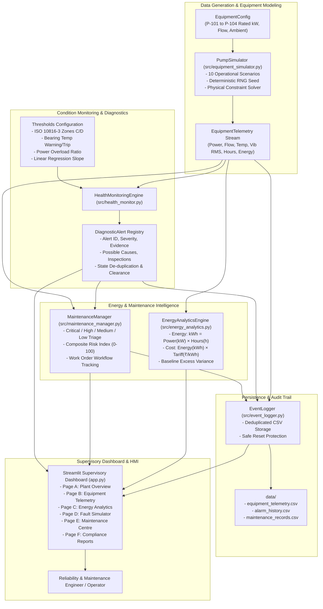

# System Architecture: Industrial Pump Health, Energy Monitoring & Predictive Maintenance System

## 1. Executive Summary

This architecture document details the modular software design of the **Industrial Pump Health, Energy Monitoring & Predictive Maintenance System**. Built specifically for industrial process plant applications (e.g., refining, petrochemicals, power generation, and utility water handling), the system provides:
1. Deterministic synthetic telemetry generation with physical consistency constraints.
2. Rule-based condition monitoring grounded in **ISO 10816-3** vibration standards and thermal limits.
3. Electrical energy accounting ($kWh = kW \times t$) and tariff-based operational expenditure modeling.
4. Explainable maintenance triage prioritizing assets based on active alerts, degradation slopes, and service hour limits.
5. Local CSV audit logging, reporting, and interactive multi-page Streamlit supervisory control (HMI).

---

## 2. Mermaid Architecture Diagram

---

## 3. Component Breakdown & Responsibilities

### 3.1 `src/equipment_simulator.py`
- **Class `EquipmentConfig`**: Holds baseline specifications (rated motor power in kW, nominal flow in m³/h, nominal casing temperature in °C, baseline vibration in mm/s RMS, service overhaul intervals).
- **Class `PumpSimulator`**: Generates synthetic telemetry snapshots.
  - Implements 10 distinct operational and degradation scenarios.
  - Enforces physical laws: stopped pumps immediately drop power draw and fluid flow to zero, damp vibration to the ambient structure baseline ($\approx 0.15\text{ mm/s}$), and exponentially decay casing heat towards ambient room temperature.
  - Accepts a deterministic random seed to guarantee test reproducibility.

### 3.2 `src/health_monitor.py`
- **Class `HealthMonitoringEngine`**: Transparent condition assessment engine.
  - **ISO 10816-3 Standards**: Evaluates root-mean-square (RMS) vibration velocity.
    - Zone A/B (Healthy): $< 2.80\text{ mm/s RMS}$
    - Zone C (Warning): $2.80 - 4.50\text{ mm/s RMS}$
    - Zone D (Critical / Danger): $> 4.50\text{ mm/s RMS}$
  - **Thermal Limits**:
    - Warning threshold at $75^\circ\text{C}$ (lubricant film thinning).
    - Critical trip threshold at $85^\circ\text{C}$ (anti-friction bearing distress).
  - **Trend Analysis**: Uses a multi-point linear regression slope across a rolling window ($N \ge 4$) to detect progressive mechanical degradation before hard limit breaches occur.
  - **Stateful De-duplication**: Tracks active alarms by `(equipment_id, condition_type)` key, preventing duplicate log spamming on supervisory dashboard refreshes. Automatically clears active flags when physical parameters normalize.

### 3.3 `src/energy_analytics.py`
- **Class `EnergyAnalyticsEngine`**:
  - Implements industrial power integration:
    $$\text{Energy } (kWh) = \text{Average Power } (kW) \times \text{Operating Duration } (hours)$$
  - Applies configurable industrial high-tension (HT) tariffs (e.g., ₹8.50/kWh).
  - Computes baseline excess energy: evaluates energy drawn above nominal design baseline (90% rated power) to calculate the financial penalty of hydraulic fouling, wear-ring recirculation, or motor overload.
  - Handles missing readings and zero operating hours gracefully without division by zero.

### 3.4 `src/maintenance_manager.py`
- **Class `MaintenanceManager`**:
  - Multi-tiered triage:
    - **Critical**: Active Critical alarms (ISO Zone D vibration, bearing temperature $>85^\circ\text{C}$, unexpected process trip). Immediate pump switchover and Lockout/Tagout (LOTO) recommended.
    - **High**: Sustained progressive degradation trend, multiple concurrent warnings, or operating hours exceeded.
    - **Medium**: Single isolated warning (mild temperature elevation or modest energy overload).
    - **Low**: All telemetry operating within normal ISO boundaries.
  - **Composite Risk Score (0-100)**: Transparent, explainable prioritization formula incorporating alert count, severity weightings, and hours elapsed.
  - **Workflow Audit**: Maintains status progression (`Normal` $\to$ `Inspection Required` $\to$ `Work Order Issued` $\to$ `Under Maintenance` $\to$ `Resolved`).

### 3.5 `src/event_logger.py` & `src/reporting.py`
- **Class `EventLogger`**: Thread-safe, deduplicated local CSV persistence in `data/`.
- **Class `ReportingEngine`**: Generates CSV downloads for telemetry time-series, historical alarm logs, maintenance work-orders, and energy cost balances.

### 3.6 `app.py`
- Streamlit multi-page interface styled with dark industrial control-room aesthetics.
- Utilizes Plotly for interactive zoomable time-series charts, threshold reference lines, and energy cost breakdowns.
- Session state caching ensures fast, stateless reruns without losing live simulation state.

---

## 4. Data Flow Architecture

1. **Simulation Phase**: Operator triggers an evaluation step or selects an operational scenario in the Fault Simulator.
2. **Telemetry Ingestion**: `PumpSimulator` computes instantaneous voltage/current power draw, hydraulic flow, thermal balance, and mechanical vibration.
3. **Condition Evaluation**: `HealthMonitoringEngine` evaluates readings against ISO 10816-3 thresholds and calculates linear regression trends over rolling history.
4. **Energy & Triage Processing**:
   - `EnergyAnalyticsEngine` calculates interval kWh and tariff cost.
   - `MaintenanceManager` calculates asset risk score and recommends physical inspection procedures.
5. **Persistence**: `EventLogger` appends deduplicated records to local CSV logs.
6. **Visualization**: Streamlit renders metrics, status pills, and Plotly charts.
